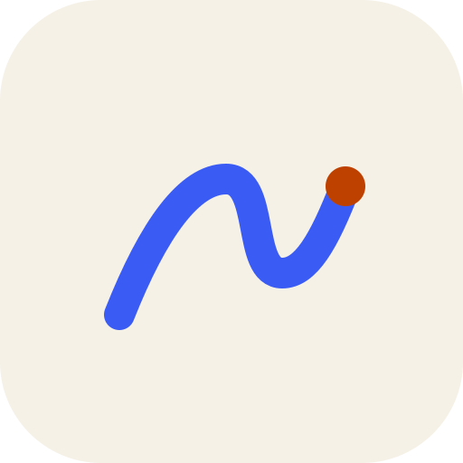
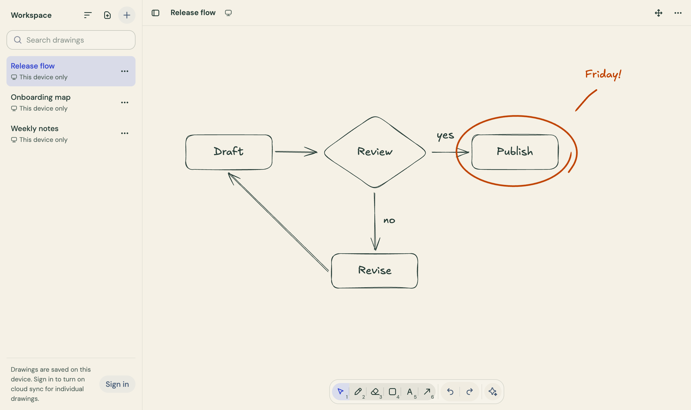
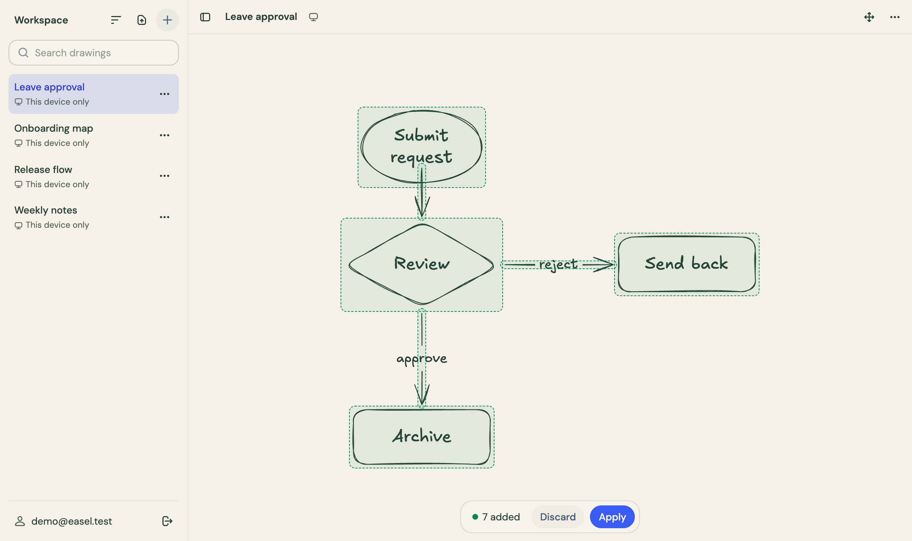
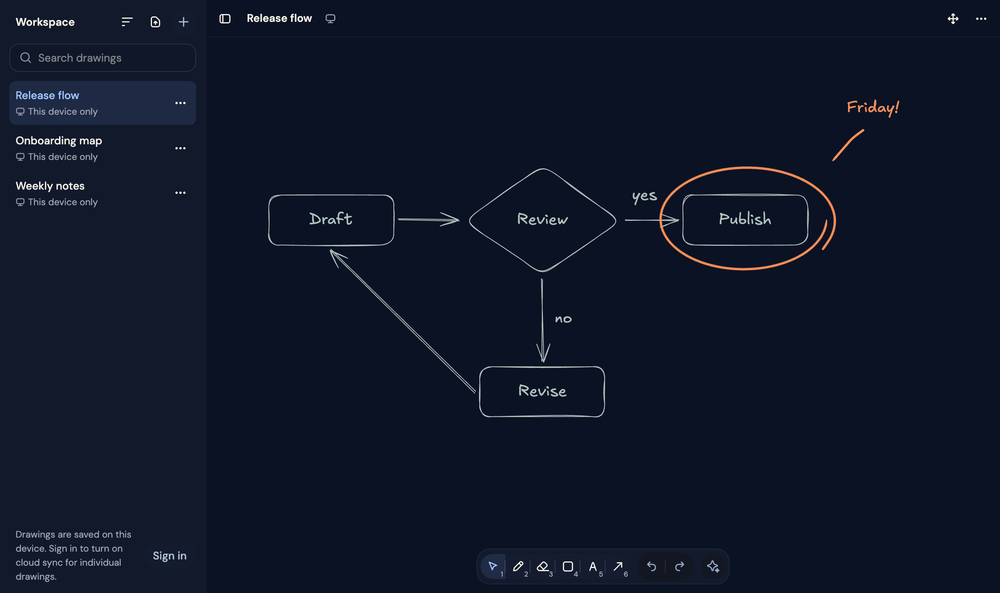

# Easel

*An offline-first whiteboard for one person.*

[简体中文](docs/zh-CN/README.md)

---

Easel puts handwriting, text, shapes, and connectors on one infinite canvas. Drag from the edge of a shape to connect it to another. Number keys switch tools.

Drawings are saved on the device, and the app works offline once installed. After signing in, new drawings sync to your account. Drawings made before signing in stay on the device unless you turn on sync for them, and any synced drawing can be moved back to the device only.

AI can draw a flowchart from a description or edit the one on the canvas. It shows the change as a preview, which you apply or discard.

 

 

<a href="docs/en/for-agents.md">For Agents</a>
<a href="https://niltavi.com/">
<picture>
  <source media="(prefers-color-scheme: dark)" srcset="public/niltavi-logo-dark.svg" />
  
</picture>
</a>

