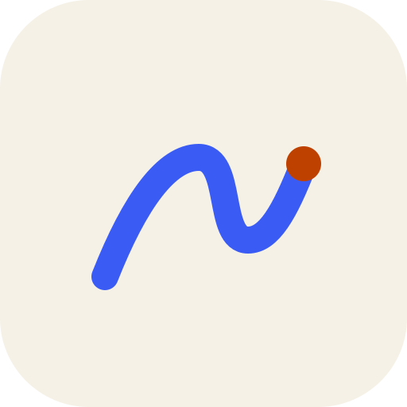
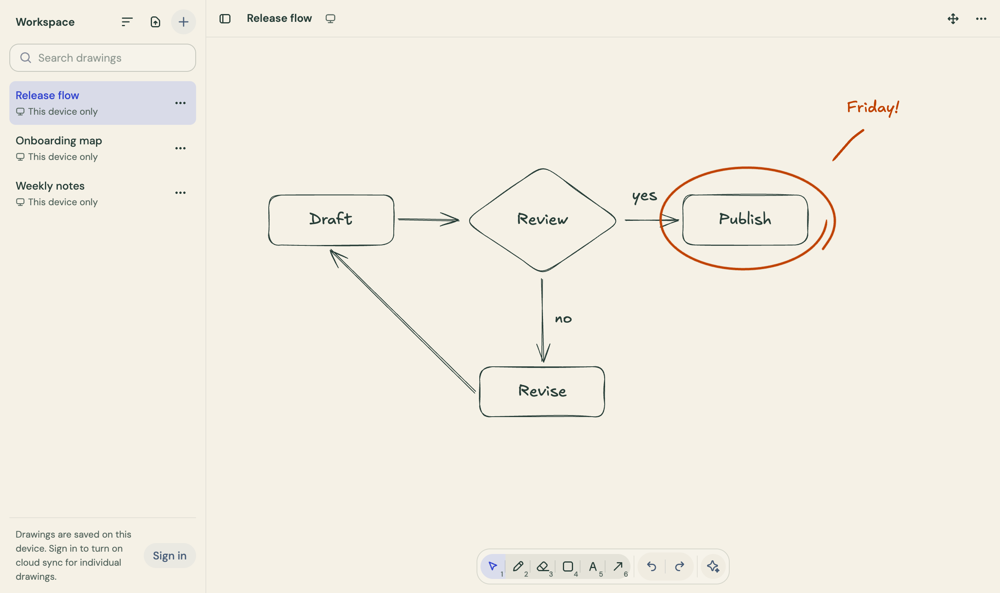
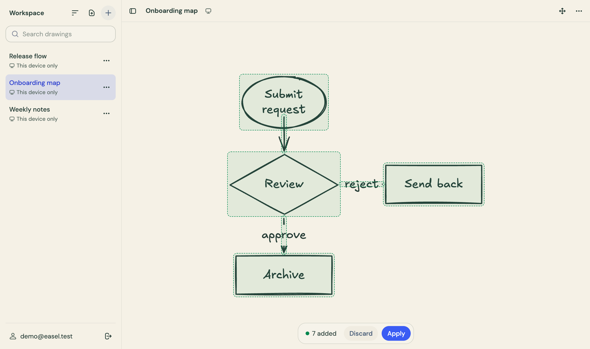
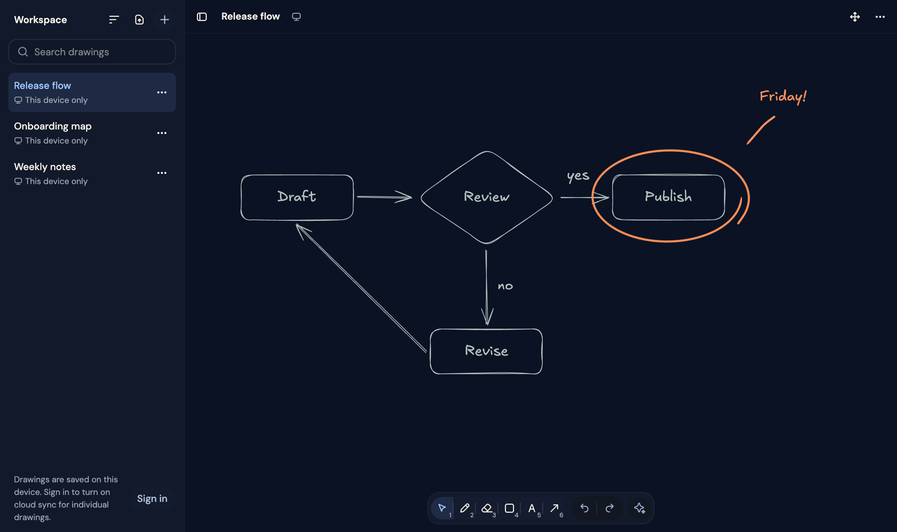

# Easel

*先落笔，别的事等一等。*

[English](../../README.md)

---

想到一个点子，打开画板，它先让你登录、选工作区、等网络。等画布终于出来，想法已经散了一半。

Easel 打开就是画布。手写、文字、形状和连线在同一张无限延伸的页面上。指针靠近一个形状，从边上拖出去就能连到另一个；按数字键切换工具。

内容保存在你的设备上，断网照常使用，可以作为应用安装在手机、平板和电脑上。想在其他设备上继续的画，单独打开同步；其余的不会离开这台设备。两台设备改了同一张画时，两份都会保留。

有些图说出来比画出来快，这时可以交给 AI。它对流程图提出修改，你先看预览，再决定应用还是放弃。

Easel 运行在你自己的机器上：一个 Node 进程，一个 SQLite 文件。界面提供英文和中文。

 

 

<a href="https://niltavi.com/">
<picture>
  <source media="(prefers-color-scheme: dark)" srcset="../assets/niltavi-logo-dark.svg" />
  
</picture>
</a>

